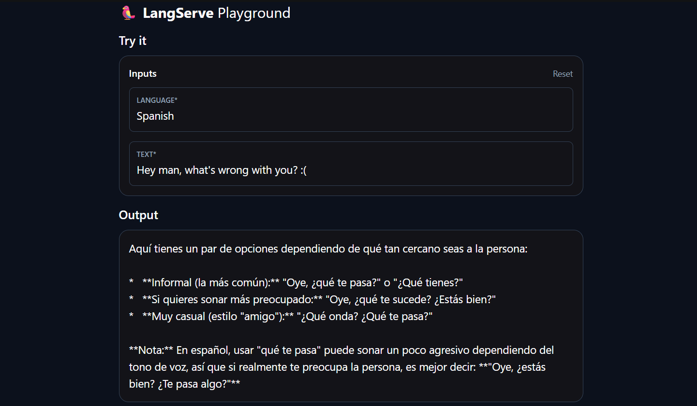

### simpleMessage.py
- > Gemini + LangChain
- LangChain kullanarak Google Gemini modeline mesaj gönderme ve modelden cevap alma dosyasıdır.

Kullanılanlar:
- ChatGoogleGenerativeAI -> Gemini modeli
- SystemMessage -> modele görev verir
- HumanMessage -> kullanıcı mesajını temsil eder
- model.invoke() -> mesajları modele gönderir
- python-dotenv -> API key'i .env dosyasından alır

### templateMessage.py
- > Prompt Template + LCEL (LangChain Expression Language)
- LangChain'de 'Prompt Template' kullanılarak dinamik prompt oluşturma ve LCEL ile zincir (chain) oluşturma örneğidir.

- ChatPromptTemplate -> System ve User mesajlarını şablon haline getirir.
- {language} ve {text} -> sonradan verilen değişkenlerdir.
- StrOutputParser -> model çıktısını string'e dönüştürür.
- | -> LangChain bileşenlerini birbirine bağlar.
- chain.invoke() -> değişkenleri prompt'a gönderip zinciri çalıştırır.

### outputParsingMessage.py
- > Output Parsing
- LangChain'de modelden gelen cevabı string (str) formatına dönüştürmek için 'StrOutputParser' kullanır.

- model -> Gemini'den cevap alır.
- model | parser -> model çıktısını parser'a aktarır.

### langServe.py
- > LangServe
- LangChain ile oluşturulan translation chain'i FastAPI + Langserve kullanarak HTTP API olarak sunar.

- FastAPI -> API sunucusunu oluşturur.
- add_routes() -> LangChain chain'ini API endpoint'ine bağlar.
- /chain -> Chain'in erişilebilir olduğunu çalıştırır.
- uvicorn -> FastAPI uygulamasını çalıştırır.

Temel akış:
Request -> FastAPI -> Langserve -> LangChain chain -> Gemini -> Response

Google Gemini('your_gemini_model'), LangChain (LCEL) ve LangServe kullanılarak geliştirilmiş dinamik çeviri uygulamasıdır.
örneğin -> your_gemini_model=gemini-2.5-flash
- > Özellikler
- LCEL (LangChain Expression Language):
  PromptTemplate | Model | OutputParser zincir yapısı.
- FastAPI & LangServe Entegrasyonu:
  /chain adresi üzerinden REST API ve interaktif /chain/playground arayüzü
- Dinamik Dil Desteği: 
  'language' ve 'text' parametreleri ile anlık dil çevirisi

- > Proje Yapısı
- simpleMessage.py -> Doğrudan Gemini modeli ile temel mesaj çağırma örneği
- outputParsingMessage.py -> Çıktıyı düz metne çeviren 'StrOutputParser' kullanımı
- templateMessage.py -> ChatPromptTemplate ile dinamik şablonlu LCEL zinciri
- langServe.py -> FastAPI ile LangServe kullanarak sunucu tarafı ve Playground arayüzü

- > Kurulum
1. Gerekli paketleri yükleyin: -> requirements.txt
   pip install -r requirements.txt

2. API anahtarınızı .env dosyasına ekleyin:
   GOOGLE_API_KEY=your_gemini_api_key
   LANGCHAIN_API_KEY=your_langchain_api_key

3. LangServe sunucusunu başlatın:
   python / py langServe.py
   
Sunucu başladıktan sonra test arayüzüne
http://localhost:8000/chain/playground/ adresinden erişebilirsiniz.